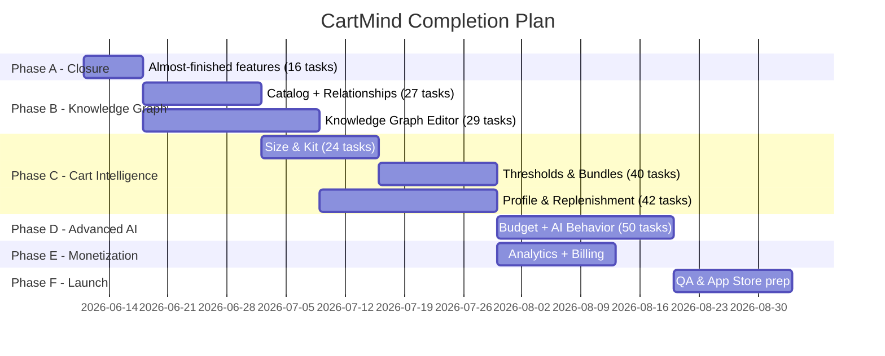

# CartMind Completion Plan

## Organization Principles

- Respect dependencies: Knowledge Graph -> Cart Intelligence -> Storefront/AI
- Prioritize MVP delivery: ship an end-to-end usable flow before edge-case polish
- Parallelize work: group independent tasks by sprint
- Deliver incrementally: each phase must produce a testable increment

---

## Phase A - Close Almost-Finished Features (1 week)

> Goal: clean up low-effort backlog and validate existing implementations.

| Feature | Remaining Work |
|---------|----------------|
| 002 - Discipline Taxonomy | LLM validation + test checklist (2 tasks) |
| 011 - Style Colorway Matching | Contract docs + performance tuning (2 tasks) |
| 014 - Storefront Chat Widget | Cart-aware orchestration T021 (1 task) |
| 017 - Product Comparison | Contract alignment + quickstart (5 tasks) |
| 025 - Shopify Storefront Integration | Bundle budget, Shopify validations, lint (6 tasks) |

**Deliverable**: 5 fully closed features. Storefront widget validated as production-ready.

---

## Phase B - Knowledge Graph & Admin Foundations (2-3 weeks)

> Goal: complete data and admin foundations so Cart Intelligence can rely on stable inputs.

### Sprint B1 - Catalog + Relationships (parallelizable)

| Feature | Scope |
|---------|-------|
| 001 - Catalog Ingestion | US4: Admin sync dashboard (Polaris cards, loaders, re-sync) + polish (11 tasks) |
| 004 - Product Relationships | US2: Merchant review UI + US3: Approved relationship API + polish (16 tasks) |

### Sprint B2 - Knowledge Graph Editor

| Feature | Scope |
|---------|-------|
| 021 - Knowledge Graph Editor | US1: Review queue + US2: Size mappings + US3: Bulk operations + polish (29 tasks) |

**Deliverable**: complete admin tooling for Knowledge Graph operations, with reliable downstream data.

---

## Phase C - Complete Cart Intelligence (3-4 weeks)

> Goal: all intelligence engines are functional and tested.

### Sprint C1 - Size & Kit (parallelizable)

| Feature | Scope |
|---------|-------|
| 008 - Size Conflict Detection | US1-US4: Evaluation, suggestions, admin preview, low-noise behavior (17 tasks) |
| 007 - Kit Completeness | US3: Polaris kit editor + polish (7 tasks) |

### Sprint C2 - Thresholds & Bundles (parallelizable)

| Feature | Scope |
|---------|-------|
| 010 - Threshold Optimization | US2-US4: Shopper payloads, suppression, admin manager (18 tasks) |
| 009 - Smart Bundle Detection | US3: Admin bundle UI + polish (5 tasks) |
| 022 - Bundle Rule Manager | US2-US3: Preview, lifecycle actions + polish (17 tasks) |

### Sprint C3 - Profile & Replenishment

| Feature | Scope |
|---------|-------|
| 012 - Customer Profile & History | US3-US4: Explicit input, confidence, noise reduction (14 tasks) |
| 013 - Replenishment Prediction | US1-US4: Full implementation (28 tasks) |

**Deliverable**: complete recommendation engine (sizes, kits, bundles, thresholds, profile, replenishment).

---

## Phase D - Advanced AI & Storefront (2-3 weeks)

> Goal: full conversational experience and checkout guidance behavior.

### Sprint D1 - Budget Optimization + AI Behavior

| Feature | Scope |
|---------|-------|
| 018 - Budget-Aware Optimization | US1 (wiring) + US2: Safety constraints + US3: Partial accept/reject (20 tasks) |
| 024 - AI Behavior Configuration | US2: Tone/starters UI + US3: Preview/publish/rollback (30 tasks) |

**Deliverable**: fully configurable merchant AI behavior and operational budget optimizer.

---

## Phase E - Analytics & Billing (2 weeks)

> Goal: monetization and operational visibility.

| Feature | Scope |
|---------|-------|
| 023 - Analytics Dashboard | Full implementation (to be planned/speced) |
| Shopify Billing API | Subscriptions, plans, and limits |

**Deliverable**: monetizable app with core usage visibility.

---

## Phase F - Final QA & Launch Prep (1-2 weeks)

- End-to-end cross-feature testing
- Performance profiling (storefront p95 < 300 ms)
- Shopify App Store review checklist
- Merchant-facing documentation
- Migration/backfill scripts for existing shops

---

## Estimated Timeline



---

## Numeric Summary

| Phase | Tasks | Estimated Duration | Prerequisites |
|-------|-------|--------------------|---------------|
| A | ~16 | 1 week | None |
| B | ~56 | 2-3 weeks | Phase A |
| C | ~81 | 3-4 weeks | Phase B |
| D | ~50 | 2-3 weeks | Phase C |
| E | ~20-30 | 2 weeks | Minimum Phase B |
| F | variable | 1-2 weeks | Phases A-D |

**Total: ~200+ tasks, ~12-15 weeks** (solo, sequential).
With parallelization (2 developers or AI-assisted): **~8-10 weeks**.

---

## MVP Prioritization Recommendation

If the objective is a fast App Store launch, reduce scope:

1. **MVP Launch** (Phases A + B + C1 + C2) = functional storefront features with size/kit/bundle/threshold intelligence
2. **Post-launch**: Replenishment (013), Advanced Customer Profile (012), Budget Optimization (018), Advanced AI Behavior (024)
3. **V2**: Analytics Dashboard, complete Knowledge Graph Editor

This reduces time-to-market to **~6-7 weeks**.

---

## Executable Backlog by Sprint

## Execution Rules

- One sprint = one internally releasable increment.
- Close code + tests first, then docs/quickstart, then final validation.
- Do not start next sprint before validating current sprint exit criteria.
- At the end of each sprint: run lint/typecheck, pass target tests, and update status in specs tasks files.

## Sprint 1 (Week 1) - Fast Closure and Stabilization

**Goal**
- Close nearly-finished features to reduce backlog noise.

**Execution Order (recommended)**
1. 025: T053 to T058
2. 014: T021
3. 017: T032 to T036
4. 002: T011 to T012
5. 011: T025 to T026

**Exit Criteria**
- 002, 011, 014, 017, 025 with zero open tasks.

## Sprint 2 (Week 2) - Admin Sync + Product Relationships

**Goal**
- Complete catalog sync admin flows and relationship foundations.

**Tasks**
1. 001: T035 to T041 (US4 admin)
2. 004: T013 to T019 (US2)
3. 001: T042 to T045 (polish)

**Exit Criteria**
- Sync dashboard is operational (load/errors/retry).
- Merchant relationship review flow is operational.

## Sprint 3 (Week 3) - Downstream Relationships + KG Editor part 1

**Goal**
- Finalize relationship read models and launch Knowledge Graph Editor.

**Tasks**
1. 004: T020 to T028 (US3 + polish)
2. 021: T016 to T022 (US1)

**Exit Criteria**
- Approved relationships available to downstream consumers.
- End-to-end Knowledge Graph review queue is usable.

## Sprint 4 (Week 4) - Knowledge Graph Editor part 2

**Goal**
- Deliver size mapping management and bulk operations.

**Tasks**
1. 021: T023 to T029 (US2)
2. 021: T030 to T037 (US3)
3. 021: T038 to T044 (polish)

**Exit Criteria**
- Stable size mapping CRUD.
- Reliable bulk preview/confirm/cancel operations.

## Sprint 5 (Week 5) - Size Conflicts + Kits

**Goal**
- Stabilize size conflict detection and kit editing workflows.

**Tasks**
1. 008: T009 to T014 (US1 + US2)
2. 007: T016 to T020 (US3)
3. 008: T015 to T019 (US3)
4. 007: T021 to T022 (polish)
5. 008: T020 to T025 (US4 + polish)

**Exit Criteria**
- Actionable size suggestions with low false positives.
- Functional admin kit editing.

## Sprint 6 (Week 6) - Thresholds + Bundle Detection

**Goal**
- Finalize threshold recommendation behavior and detected bundle admin tools.

**Tasks**
1. 010: T013 to T017 (US2)
2. 009: T019, T021, T022 (US3)
3. 010: T018 to T022 (US3)
4. 009: T024 to T025 (polish)
5. 010: T023 to T030 (US4 + polish)

**Exit Criteria**
- Robust threshold recommendations (eligible/suppressed).
- Admin-manageable bundle rules.

## Sprint 7 (Week 7) - Bundle Rule Manager

**Goal**
- Deliver full lifecycle management for bundle rules.

**Tasks**
1. 022: T019 to T025 (US2)
2. 022: T026 to T032 (US3)
3. 022: T033 to T035 (polish)

**Exit Criteria**
- Valid preview + lifecycle actions (pause/archive/duplicate).

## Sprint 8 (Weeks 8-9) - Customer Profile + Replenishment

**Goal**
- Add historical shopper intelligence and replenishment logic.

**Tasks**
1. 012: T020 to T024 (US3)
2. 013: T009 to T014 (US1)
3. 012: T025 to T029 (US4)
4. 013: T015 to T020 (US2)
5. 012: T030 to T033 (polish)
6. 013: T021 to T027 (US3)
7. 013: T028 to T036 (US4 + polish)

**Exit Criteria**
- Robust personalization (precedence/confidence/noise control).
- End-to-end replenishment with order webhook integration.

## Sprint 9 (Weeks 10-11) - AI Behavior + Budget Optimization

**Goal**
- Enable merchant-controlled AI behavior and finalize budget optimization.

**Tasks**
1. 018: T019 (remaining US1)
2. 024: T032 to T043 (US2)
3. 018: T020 to T026 (US2)
4. 024: T044 to T055 (US3)
5. 018: T027 to T033 (US3)
6. 024: T056 to T061 (polish)
7. 018: T034 to T038 (polish)

**Exit Criteria**
- Operational AI preview/publish/rollback.
- Budget optimizer with safety guardrails and partial states.

## Sprint 10 (Week 12) - Analytics + Billing + Release Candidate

**Goal**
- Finalize monetization, observability, and App Store prep.

**Tasks**
1. 023: define plan/spec/tasks, then execute implementation
2. Shopify Billing: complete and tested implementation
3. Final cross-cutting QA: e2e, performance, Shopify compliance

**Exit Criteria**
- App Store candidate release with complete checklist.

## Definition of Done (per sprint)

- All sprint tasks checked in the feature tasks file.
- Global typecheck passes.
- Global lint passes.
- Feature target tests pass (unit + integration).
- No critical regression on recommendation/chat APIs, storefront widget, or Shopify extensions.

## Standard End-of-Sprint Commands

```bash
npm run lint
npm run typecheck
npm exec vitest --run
```

## Shopify Commands (storefront/extensions sprints)

```bash
shopify app config use
shopify app deploy --no-release
shopify app dev
```

## Short Plan for Fast App Store Launch (6-7 weeks)

1. Sprints 1 through 7 (solid MVP storefront + core intelligence)
2. Sprints 8 and 9 post-launch
3. Sprint 10 as scale-up (analytics + advanced billing)

---

## Sprint 1 Day-by-Day Breakdown (D1 -> D5)

## D1 - Shopify Storefront Integration (part 1)

**Daily Goal**
- Start and complete performance/budget tasks for feature 025.

**Tasks**
1. 025: T053 (budget/perf helper)
2. 025: T054 (package scripts)

**End-of-Day Validation**
- Budget script available and executable locally.
- NPM scripts wired to budget/performance checks.

## D2 - Shopify Storefront Integration (part 2)

**Daily Goal**
- Fully close feature 025.

**Tasks**
1. 025: T055 (manual validation results)
2. 025: T056 (targeted validation runs)
3. 025: T057 (Shopify config validation)
4. 025: T058 (final lint + typecheck)

**End-of-Day Validation**
- 025 fully closed (no open tasks in tasks file).

## D3 - Storefront Chat + Product Comparison

**Daily Goal**
- Close 014, then progress heavily on 017.

**Tasks**
1. 014: T021
2. 017: T032
3. 017: T033
4. 017: T034

**End-of-Day Validation**
- 014 closed.
- Core 017 contracts aligned.

## D4 - Product Comparison Final + Discipline Taxonomy

**Daily Goal**
- Close 017 and 002.

**Tasks**
1. 017: T035
2. 017: T036
3. 002: T011
4. 002: T012

**End-of-Day Validation**
- 017 closed.
- 002 closed.

## D5 - Style/Colorway + Sprint 1 Global Validation

**Daily Goal**
- Close 011 and validate the full sprint.

**Tasks**
1. 011: T025
2. 011: T026
3. Sprint review: verify 002, 011, 014, 017, 025 have zero remaining tasks
4. Execute sprint-level validation

**Sprint 1 Closing Commands**

```bash
npm run lint
npm run typecheck
npm exec vitest --run
```

**End-of-Sprint Validation**
- 5 features closed: 002, 011, 014, 017, 025.
- No critical blockers on storefront widget, checkout extension, or related API contracts.

## Sprint 1 Risks and Mitigation

- Risk: T057 (Shopify validation) blocked by environment.
  Mitigation: run T057 early on D2; if blocked externally, continue T055/T056/T058 and retry after environment fix.
- Risk: 017 contract alignment takes longer than expected.
  Mitigation: prioritize T032-T034 on D3 to de-risk the end of sprint.
- Risk: late lint/typecheck regression.
  Mitigation: run lint/typecheck at end of each day, not only D5.

---

## Sprint 2 Day-by-Day Breakdown (D1 -> D5)

## D1 - Catalog Ingestion US4 (tests + loaders)

**Daily Goal**
- Establish tests and loader foundations for admin sync status.

**Tasks**
1. 001: T035 (integration tests sync summary/failures)
2. 001: T036 (sync-status component tests)
3. 001: T037 (sync-status + failed products loaders)

**End-of-Day Validation**
- Tests added and executed locally (even partially red before full implementation).
- app index loader exposes expected admin component data.

## D2 - Catalog Ingestion US4 (Polaris UI + actions)

**Daily Goal**
- Make sync dashboard useful and actionable for merchants.

**Tasks**
1. 001: T038 (Polaris SyncStatusCard)
2. 001: T039 (Polaris SyncFailureTable)
3. 001: T040 (manual re-sync action with single-active-job guard)
4. 001: T041 (progress + permanent failure details)

**End-of-Day Validation**
- Full admin sync screen aligned with loaders.
- Manual re-sync action available with guardrails.

## D3 - Product Relationships US2 (tests + queries)

**Daily Goal**
- Start merchant relationship review flow with test coverage first.

**Tasks**
1. 004: T013 (unit tests for override precedence + normalization)
2. 004: T014 (integration tests for merchant review actions)
3. 004: T015 (candidate + active-link queries)
4. 004: T018 (override/suppression persistence)

**End-of-Day Validation**
- Relationship persistence model validated by unit/integration tests.

## D4 - Product Relationships US2 (UI + actions)

**Daily Goal**
- Complete full admin relationship review flow.

**Tasks**
1. 004: T016 (embedded review UI)
2. 004: T017 (create/approve/update/reject/disable actions)
3. 004: T019 (preserve merchant decisions across remapping)

**End-of-Day Validation**
- Merchants can review, approve, modify, and disable relationships without decision loss during remapping.

## D5 - 001 Polish + Sprint 2 Global Validation

**Daily Goal**
- Close 001 polish tasks and validate overall sprint stability.

**Tasks**
1. 001: T042 (setup/env vars/operations docs)
2. 001: T043 (logs/errors hardening)
3. 001: T044 (dashboard copy/empty states)
4. 001: T045 (final lint/typecheck validation)
5. Sprint review: confirm Sprint 2 closures (001 US4+polish, 004 US2)

**Sprint 2 Closing Commands**

```bash
npm run lint
npm run typecheck
npm exec vitest -- tests/integration/routes/app-index-sync-status.test.ts --run
npm exec vitest -- tests/integration/routes/knowledge-graph-relationships.test.ts --run
```

**End-of-Sprint Validation**
- 001 US4 + polish closed.
- 004 US2 closed.
- Admin sync status and relationship review flows are usable in dev environment.

## Sprint 2 Risks and Mitigation

- Risk: unstable integration tests on admin routes.
  Mitigation: stabilize test fixtures first, then lock loaders before UI rendering.
- Risk: regressions in app index route during dashboard additions.
  Mitigation: run route integration tests after each major loader/action change.
- Risk: inconsistent persistence for relationship overrides.
  Mitigation: prioritize T013/T014 before T016/T017 to secure business behavior.

---

## Sprint 3 Day-by-Day Breakdown (D1 -> D5)

## D1 - Product Relationships US3 (Read Models + Tests)

**Daily Goal**
- Build and validate approved-relationship read behavior.

**Tasks**
1. 004: T020 (unit tests for approved filtering/ordering)
2. 004: T021 (integration coverage for approved reads)
3. 004: T022 (approved relationship read-model queries)

**End-of-Day Validation**
- Approved relationship read path is test-covered and query-backed.

## D2 - Product Relationships US3 (Downstream Access)

**Daily Goal**
- Expose approved relationships safely to downstream consumers.

**Tasks**
1. 004: T023 (retrieval + filtering helpers)
2. 004: T024 (trusted relationship accessor exports)
3. 004: T025 (webhook invalidation regression coverage)

**End-of-Day Validation**
- Downstream accessors are available with invalidation regression protection.

## D3 - Product Relationships Polish

**Daily Goal**
- Finish lifecycle coverage and optimization for feature 004.

**Tasks**
1. 004: T026 (product lifecycle regression integration tests)
2. 004: T027 (candidate bounds/dedup/invalidation optimization)
3. 004: T028 (end-to-end verification + quickstart notes)

**End-of-Day Validation**
- 004 is fully closed (US3 + polish).

## D4 - Knowledge Graph Editor US1 (Core Behavior)

**Daily Goal**
- Start KG Editor with queue/review mutation foundations.

**Tasks**
1. 021: T016 (review-status transition handler)
2. 021: T017 (admin handlers for queue/override/relationship mutations)
3. 021: T018 (Polaris review queue list + filters)
4. 021: T019 (Polaris override/relationship editor panels)

**End-of-Day Validation**
- Core queue/review edit behavior is operational in admin UI.

## D5 - Knowledge Graph Editor US1 (Integration + Tests)

**Daily Goal**
- Close US1 for feature 021 with integration and coverage.

**Tasks**
1. 021: T020 (integrate editor shell with queue and mutation actions)
2. 021: T021 (unit tests queue ordering + override precedence)
3. 021: T022 (integration tests classification/relationship mutation flows)
4. Sprint review: confirm 004 closure and 021 US1 closure

**Sprint 3 Closing Commands**

```bash
npm run lint
npm run typecheck
npm exec vitest -- tests/integration/routes/knowledge-graph-relationships.test.ts --run
npm exec vitest -- tests/integration/knowledge-graph-editor/review-mutations.test.ts --run
```

**End-of-Sprint Validation**
- 004 US3 + polish closed.
- 021 US1 closed.
- Approved relationship access and KG review queue are both operational.

## Sprint 3 Risks and Mitigation

- Risk: downstream consumers expect relationship payloads that differ from the new approved-read model.
  Mitigation: lock response shapes in tests before broad helper rollout.
- Risk: queue actions in feature 021 introduce inconsistent states.
  Mitigation: enforce transition checks in handlers before UI writes.
- Risk: regressions from webhook invalidation changes spill into unrelated flows.
  Mitigation: run lifecycle + webhook regression suites before sprint sign-off.

---

## Sprint 4 Day-by-Day Breakdown (D1 -> D5)

## D1 - Knowledge Graph Editor US2 (Validation + Persistence Core)

**Daily Goal**
- Build the core size-mapping validation and persistence flow.

**Tasks**
1. 021: T023 (size mapping validation rules + contradiction detection)
2. 021: T024 (size mapping upsert/deactivate with revision checks)
3. 021: T028 (unit tests for validation + contradiction rejection)

**End-of-Day Validation**
- Validation and persistence rules are implemented and unit-test covered.

## D2 - Knowledge Graph Editor US2 (Route + UI)

**Daily Goal**
- Expose CRUD through route actions and complete the admin panel UI.

**Tasks**
1. 021: T025 (route actions for size mapping CRUD + conflict responses)
2. 021: T026 (Polaris size mapping table + editor form)
3. 021: T027 (panel state integration + mutation feedback)
4. 021: T029 (integration tests for CRUD + rejection semantics)

**End-of-Day Validation**
- End-to-end size mapping CRUD is operational and integration-tested.

## D3 - Knowledge Graph Editor US3 (Bulk Foundations)

**Daily Goal**
- Build deterministic bulk preview and confirmation guards.

**Tasks**
1. 021: T030 (bulk target resolver + deterministic filter snapshots)
2. 021: T031 (preview hash generation + confirmation guards)
3. 021: T032 (bulk execution orchestrator + per-record aggregation)

**End-of-Day Validation**
- Bulk operation backend flow is deterministic and safely guardrailed.

## D4 - Knowledge Graph Editor US3 (Route + UI)

**Daily Goal**
- Complete user-facing bulk operations in admin.

**Tasks**
1. 021: T033 (bulk route actions: preview/confirm/cancel/status)
2. 021: T034 (Polaris bulk preview/confirm/cancel UI)
3. 021: T035 (integrate bulk panel into editor shell/navigation)
4. 021: T036 (unit tests for preview hash + status transitions)
5. 021: T037 (integration tests for confirm/cancel/no-op guarantees)

**End-of-Day Validation**
- Bulk operations are available in UI and protected by end-to-end tests.

## D5 - Knowledge Graph Editor Polish + Sprint 4 Validation

**Daily Goal**
- Close polish tasks and finalize Sprint 4 with full validation.

**Tasks**
1. 021: T038 (change-history viewer query + pagination)
2. 021: T039 (Polaris audit trail panel)
3. 021: T040 (propagation metrics + retry-flag logging)
4. 021: T041 (propagation contract integration test)
5. 021: T042 (stale-write conflict integration test)
6. 021: T043 (quickstart scenario validation + recorded outcomes)
7. 021: T044 (contract/design consistency validation notes)

**Sprint 4 Closing Commands**

```bash
npm run lint
npm run typecheck
npm exec vitest -- tests/integration/knowledge-graph-editor/bulk-actions.test.ts --run
npm exec vitest -- tests/integration/knowledge-graph-editor/propagation-contract.test.ts --run
```

**End-of-Sprint Validation**
- 021 US2 + US3 + polish closed.
- Knowledge Graph Editor supports CRUD, bulk operations, history, and propagation checks.

## Sprint 4 Risks and Mitigation

- Risk: race conditions in bulk confirm/cancel flows.
  Mitigation: enforce preview hash checks and explicit status transitions before writes.
- Risk: stale-write handling introduces false conflicts.
  Mitigation: validate optimistic concurrency behavior with targeted integration tests before release.
- Risk: propagation metrics add overhead to hot paths.
  Mitigation: keep logging lightweight and verify p95 impact during sprint sign-off.

---

## Sprint 5 Day-by-Day Breakdown (D1 -> D5)

## D1 - Size Conflict Detection (US1 + US2 Foundations)

**Daily Goal**
- Build supported normalized size-rule evaluation and suggestion foundations.

**Tasks**
1. 008: T009 (normalized size-rule evaluation for supported category pairs)
2. 008: T010 (unit tests: expected-size/in-stock/out-of-stock/rerun behavior)
3. 008: T011 (payload-building + primary-suggestion selection tests)

**End-of-Day Validation**
- Core evaluation path exists and is covered by baseline unit tests.

## D2 - Size Conflict Detection (US2 Completion)

**Daily Goal**
- Finalize actionable shopper-facing conflict suggestions.

**Tasks**
1. 008: T012 (structured suggestions from mappings + availability lookups)
2. 008: T013 (shopper-facing payload builders aligned with contract)
3. 008: T014 (shared sizing types + explanation helpers update)

**End-of-Day Validation**
- Conflict responses provide actionable, inventory-aware guidance.

## D3 - Kit Completeness US3 (Admin Editor)

**Daily Goal**
- Deliver complete admin editing flow for kits.

**Tasks**
1. 007: T016 (loader/action integration coverage for Kits tab)
2. 007: T017 (loader: kit definitions/tags/options)
3. 007: T018 (validated action intents for save/delete/archive flows)
4. 007: T019 (Polaris Kits tab UI)
5. 007: T020 (preserve merchant-authored kits across reseeds)

**End-of-Day Validation**
- Merchant can create/edit/archive kit definitions safely in admin.

## D4 - Size Conflict Detection US3 (Admin Preview + Management)

**Daily Goal**
- Enable admin preview and richer compatibility management flows.

**Tasks**
1. 008: T015 (loader/action integration coverage for size compatibility tooling)
2. 008: T016 (loader returns preview state + richer mapping data)
3. 008: T017 (validated preview-cross-size-conflict action)
4. 008: T018 (Polaris preview + compatibility management UI)
5. 008: T019 (preserve merchant compatibility overrides across reset/reseed)

**End-of-Day Validation**
- Admin preview and compatibility management are fully functional.

## D5 - Size Conflict US4 + Polish + Sprint 5 Validation

**Daily Goal**
- Reduce noise/false positives and close sprint-level polish tasks.

**Tasks**
1. 008: T020 (unit tests for low-noise edge cases)
2. 008: T021 (tighten skip/dedupe/unsupported-label handling)
3. 008: T022 (filter incomplete/non-sized inputs before evaluation)
4. 008: T023 (refine fallback payload behavior for low-confidence suggestions)
5. 007: T021 (update operator steps/validation commands in quickstart)
6. 007: T022 (run targeted TypeScript + Vitest suites)
7. 008: T024 (update quickstart with focused tests + manual validation)
8. 008: T025 (run TypeScript + focused Vitest suites)

**Sprint 5 Closing Commands**

```bash
npm run lint
npm run typecheck
npm exec vitest -- tests/unit/knowledge-graph/kits.test.ts --run
npm exec vitest -- tests/unit/knowledge-graph/size-conflicts.test.ts --run
npm exec vitest -- tests/integration/routes/knowledge-graph-size-conflicts.test.ts --run
```

**End-of-Sprint Validation**
- 007 US3 + polish closed.
- 008 US1-US4 + polish closed.
- Size conflict recommendations are actionable with improved low-noise behavior.

## Sprint 5 Risks and Mitigation

- Risk: size suggestion logic drifts from inventory availability in edge cases.
  Mitigation: keep availability checks in evaluation core and lock with focused unit tests.
- Risk: kit reseed workflows overwrite merchant-authored data.
  Mitigation: preserve merchant precedence in persistence layer and verify via reseed regression tests.
- Risk: admin preview and runtime recommendation logic diverge.
  Mitigation: reuse shared evaluators and keep contract tests synchronized across both surfaces.

---

## Sprint 6 Day-by-Day Breakdown (D1 -> D5)

## D1 - Threshold Optimization US2 (Reasoning + Shopper Payloads)

**Daily Goal**
- Add complete threshold reasoning and shopper-facing payload structure.

**Tasks**
1. 010: T013 (threshold unit coverage for reasoning/unlock messaging)
2. 010: T014 (shopper payload coverage in recommendations tests)
3. 010: T015 (selection reasons + candidate reasoning + overshoot metadata)
4. 010: T016 (shopper threshold summary/suggestion payload builders)
5. 010: T017 (benefit/price/unlock message shaping helpers)

**End-of-Day Validation**
- Threshold recommendation outputs include consistent reasoning and user-facing messaging.

## D2 - Smart Bundle Detection US3 (Admin Bundle Manager Core)

**Daily Goal**
- Deliver core admin bundle management behavior for feature 009.

**Tasks**
1. 009: T019 (template/activation-guard/projection coverage)
2. 009: T021 (Polaris bundle manager UI + preview flow + controls)
3. 009: T022 (activation safeguards + duplicate-key handling + projection persistence)

**End-of-Day Validation**
- Bundle manager supports creation and guarded activation flow in admin.

## D3 - Threshold Optimization US3 (Suppression & Noise Control)

**Daily Goal**
- Implement suppression policies and low-noise threshold behavior.

**Tasks**
1. 010: T018 (suppression-path unit coverage)
2. 010: T019 (hidden/qualified summary-state assertions)
3. 010: T020 (suppression policies + relevance floors + availability filtering)
4. 010: T021 (duplicate-suggestion safeguards + mixed-discipline prioritization)
5. 010: T022 (hide prompts for suppressed outcomes + passive qualified summaries)

**End-of-Day Validation**
- Suppressed outcomes are reliably hidden and qualified states remain informative but non-intrusive.

## D4 - Threshold Optimization US4 (Admin Manager + Rule Lifecycle)

**Daily Goal**
- Complete threshold admin manager and rule lifecycle operations.

**Tasks**
1. 010: T023 (loader/action integration coverage for threshold manager)
2. 010: T024 (template/duplicate-key/rule-shaping unit coverage)
3. 010: T025 (loader + validated save/preview/archive actions)
4. 010: T026 (Polaris threshold manager UI + preview workflow)
5. 010: T027 (duplicate-key handling + activation safeguards + preview shaping)
6. 010: T028 (embed admin navigation update + placeholder retirement)

**End-of-Day Validation**
- Threshold rules are manageable end-to-end from admin with validation and preview.

## D5 - Sprint 6 Polish + Full Validation

**Daily Goal**
- Close Sprint 6 polish tasks and certify stability.

**Tasks**
1. 009: T024 (update quickstart with final commands/flows)
2. 009: T025 (run focused TypeScript + Vitest suites)
3. 010: T029 (update quickstart with final Prisma/preview/validation flow)
4. 010: T030 (run TypeScript + focused Vitest suites)

**Sprint 6 Closing Commands**

```bash
npm run lint
npm run typecheck
npm exec vitest -- tests/unit/cart-intelligence/threshold.test.ts --run
npm exec vitest -- tests/unit/cart-intelligence/threshold-recommendations.test.ts --run
npm exec vitest -- tests/unit/knowledge-graph/bundles.test.ts --run
npm exec vitest -- tests/integration/routes/threshold-manager.test.ts --run
```

**End-of-Sprint Validation**
- 010 US2-US4 + polish closed.
- 009 US3 + polish closed.
- Threshold and bundle detection admin workflows are stable and validated.

## Sprint 6 Risks and Mitigation

- Risk: threshold suppression hides genuinely useful recommendations.
  Mitigation: lock suppression logic with scenario-based tests and review qualified/suppressed boundaries.
- Risk: duplicate-key and activation safeguards conflict with real merchant workflows.
  Mitigation: cover guardrail semantics in loader/action integration tests before enabling broadly.
- Risk: threshold manager UI diverges from contract payload shape.
  Mitigation: enforce contract-driven tests and keep preview payload builders shared.

---

## Sprint 7 Day-by-Day Breakdown (D1 -> D5)

## D1 - Bundle Rule Manager US2 (Preview Engine Backend)

**Daily Goal**
- Build preview engine behavior and compact projection helpers.

**Tasks**
1. 022: T019 (preview action endpoint using shared evaluator)
2. 022: T020 (preview cart-line normalization + catalog existence checks)
3. 022: T021 (overlap candidate reporting with tie-break reasons)
4. 022: T025 (compact active-rule projection helper for downstream consumers)

**End-of-Day Validation**
- Preview backend returns qualified/missing/overlap outcomes with deterministic reasoning.

## D2 - Bundle Rule Manager US2 (Preview UI + Route Integration)

**Daily Goal**
- Expose preview engine to merchants with complete UI flow.

**Tasks**
1. 022: T022 (preview request builder UI)
2. 022: T023 (qualification result + missing requirements + decision trace UI)
3. 022: T024 (preview result integration in route composition)

**End-of-Day Validation**
- Merchant can build preview input and inspect decision traces directly in admin.

## D3 - Bundle Rule Manager US3 (Lifecycle Actions Backend)

**Daily Goal**
- Implement lifecycle transitions and persistence/audit guarantees.

**Tasks**
1. 022: T026 (ACTIVE<->PAUSED transition actions)
2. 022: T027 (archive action + archived filter behavior)
3. 022: T028 (duplicate-rule persistence with draft reset)
4. 022: T029 (immutable audit events for lifecycle actions)
5. 022: T031 (lifecycle transition guards + failure semantics)

**End-of-Day Validation**
- Lifecycle transitions are auditable, guarded, and persistence-safe.

## D4 - Bundle Rule Manager US3 (Lifecycle UI + Filtering)

**Daily Goal**
- Complete lifecycle controls and route-level filtering/search.

**Tasks**
1. 022: T030 (lifecycle action controls UI: pause/archive/duplicate)
2. 022: T032 (archived/default filtering + search in loader)
3. Validate US2+US3 integration path end-to-end in admin

**End-of-Day Validation**
- Rule list supports lifecycle actions, filters, and search with coherent state transitions.

## D5 - Sprint 7 Polish + Full Validation

**Daily Goal**
- Finish cross-cutting polish and finalize Sprint 7.

**Tasks**
1. 022: T033 (projection versioning + fallback behavior checks)
2. 022: T034 (quickstart verification notes update)
3. 022: T035 (run full feature validation checklist and mark outcomes)

**Sprint 7 Closing Commands**

```bash
npm run lint
npm run typecheck
npm exec vitest -- tests/integration/routes/bundle-rule-manager.test.ts --run
npm exec vitest -- tests/unit/cart-intelligence/bundle-detection.test.ts --run
npm exec vitest -- tests/unit/cart-intelligence/bundle-recommendations.test.ts --run
```

**End-of-Sprint Validation**
- 022 US2-US3 + polish closed.
- Bundle rule lifecycle management and preview tooling are production-ready in admin.

## Sprint 7 Risks and Mitigation

- Risk: lifecycle transitions create inconsistent rule visibility between active and archived lists.
  Mitigation: enforce status filters at query level and validate transitions with integration tests.
- Risk: overlap tie-break logic confuses merchants when preview differs from expectation.
  Mitigation: expose explicit decision trace and tie-break rationale in preview UI.
- Risk: projection version changes break downstream consumers.
  Mitigation: add versioned fallback behavior and lock compatibility in focused contract tests.
